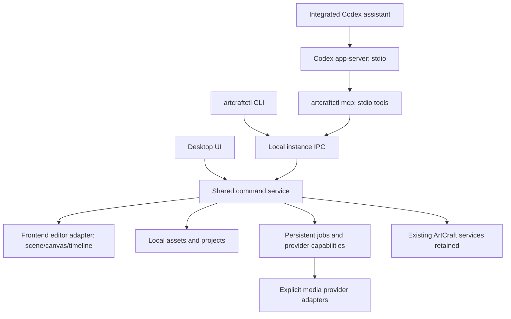

# Codex integration and native agent control

Status: proposed implementation plan; no application code changed.

Prepared on 2026-10-09 against upstream commit
`3e5793b6934b51536606720e5d56bcfd1fe7cc2d`.
Fork: <https://github.com/aberemia24/artcraft>.

## Requested outcome and feasibility

The requested target is to replace ArtCraft-credit generation with ChatGPT/Codex
OAuth throughout the app, and give an agent native control through MCP, a CLI,
or both. Recommend **both**, sharing one command service with the desktop UI.

The complete replacement target has two unresolved prerequisites:

1. [LICENSE.md](../LICENSE.md) explicitly prohibits removing paid model services,
   community links, or donation links from a fork. Keep them in the additive
   implementation. Obtain permission from the authors before implementing the
   removal target; user approval alone does not settle this restriction. The
   repository is fair source, not an OSI open-source licensed repository.
2. ChatGPT OAuth authorizes particular workloads, not every media model in
   ArtCraft. The documented Sign in with ChatGPT plan-usage route currently
   excludes image generation. Video, music, meshes, and worlds are not established
   replacements through that route. Do not advertise complete generation parity
   or free/unlimited generation from a ChatGPT subscription.

An additive Codex assistant and native MCP/CLI can proceed independently of full
media replacement. This is the recommended first implementation, not a claim
that the original replacement request has been fulfilled.

Assumptions: Windows desktop first, local use, user-selected account, no hosted
multi-user service. Publishing modified binaries or commercial use needs a
separate license review. No author outreach is authorized by this plan.

## What the current source actually does

| Area                     | Evidence in this checkout                                                                                            | Consequence                                                                                             |
| ------------------------ | -------------------------------------------------------------------------------------------------------------------- | ------------------------------------------------------------------------------------------------------- |
| Desktop composition      | `crates/desktop/artcraft/src/lib.rs`                                                                                 | Tauri registers native generation, provider, media, and task commands.                                  |
| Generation dispatch      | `crates/desktop/artcraft/src/core/commands/generate/omni/{request,dispatch}.rs`                                      | Default ArtCraft requests require its session, call `/v1/omni_gen/*`, and persist provider jobs.        |
| Image routing            | `crates/desktop/artcraft/src/core/commands/generate/generate_image/generate_image_command.rs`                        | Images have Omni and legacy provider paths; editing one route is insufficient.                          |
| Audio and mesh           | `crates/desktop/artcraft/src/core/commands/generate/{generate_audio_command,generate_mesh_command}.rs`               | Current commands reject direct providers for these modalities.                                          |
| Video and splats         | `crates/desktop/artcraft/src/core/commands/generate/{generate_video,generate_splat_command.rs}`                      | These have additional native/legacy routing paths requiring separate coverage.                          |
| External results         | `crates/desktop/artcraft/src/core/threads/third_party_task_polling_thread/handlers/fal/handle_fal_complete.rs`       | This external provider completion still requires Storyteller credentials and uploads to its backend.    |
| Provider clients         | `crates/api_clients/artcraft/artcraft_router/src/client/multi_router_client.rs`                                      | Multiple optional clients exist; this does not establish that each is wired into every desktop flow.    |
| Model discovery          | `crates/desktop/artcraft/src/core/commands/generate/models/image/list_image_models_command.rs`                       | The desktop image catalog is fetched from ArtCraft's API.                                               |
| Frontend wrappers        | `frontend/libs/tauri-api/src/lib/generate/`                                                                          | Native wrappers cover image, video, audio, mesh, and splat commands.                                    |
| Direct frontend route    | `frontend/libs/components/promptbox/src/lib/PromptBox3D.tsx`                                                         | A generation path directly calls `OmniGenApi.generateImage` and uploads a scene snapshot.               |
| Canvas integration       | `frontend/apps/artcraft/app/src/pages/PageDraw/PageDraw.tsx`                                                         | Edit/inpaint use native commands, but image upload and completion artifacts use cloud media tokens.     |
| Scene integration        | `frontend/apps/artcraft/app/src/pages/PageScene/useTauriPageSceneAdapter.tsx`                                        | Scene save, load, covers, gallery, and asset URLs depend on host/cloud adapters.                        |
| Scene engine             | `frontend/libs/components/pagescene/src/lib/engine/{editor,save_manager}.ts`                                         | The live editor has serialization, loading, snapshots, and history; scene control belongs here.         |
| Local task storage       | `crates/schema/database/sqlite_tasks/src/queries/task.rs` and `_database/sql/artcraft_migrations/`                   | Task schema embeds shared provider enums and cloud-oriented fields; extend it with migrations.          |
| Existing MCP references  | `crates/api_clients/artcraft/artcraft_api_defs/src/mcp_sessions/` and scene guidance                                 | Session API types and mentions of an unfinished scene integration do not constitute a local server.     |

The production backend lives in the separate `artcraft-services` repository,
which was not inspected here. This fork cannot assume that service is available
to build, alter, or redistribute. This is a source audit, not a successful build
or runtime compatibility test.

## Authentication and media capabilities

Use `codex app-server` as a local subprocess over stdio, with a pinned version
and schemas generated from that version. It is a bidirectional JSON-RPC
interface, not the ArtCraft MCP server and not a general media API.

**Initial route:** evaluate app-server-managed ChatGPT login for this local
integration. It exposes `account/read`, `account/login/start` with
`type: "chatgpt"`, login completion, logout, rate limits, threads, turns, and
streamed events. Keep the integration in an app-owned Codex profile rather than
reading or modifying the user's existing Codex credentials/configuration.
Open the sign-in URL in the system browser; Codex owns token renewal in this mode.

**Preferred migration route if eligible:** Sign in with ChatGPT owned by the app,
with plan usage consent and app-server configured for the supported Responses
provider. Confirm applicability to this fair-source/local application before
choosing this flow. Use PKCE, state and nonce validation, a loopback callback,
validated identity, stable host ID, protected per-account credentials, rotating
refresh tokens, and no secrets in the renderer. The host owns token renewal and
restarts/resumes app-server after renewal in the documented env-token setup.

These are separate authentication implementations. Do not mix their tokens,
refresh ownership, account identifiers, or assumptions about supported tools.
Native app-server login and Sign in with ChatGPT have different capability
evidence; a successful text turn proves neither media generation nor API access
to a different product.

Use `gpt-6.1-sol` explicitly for any Codex agent launched by this integration,
with `low`, `medium`, or `high` reasoning effort. Default to `medium`. Do not
substitute a model if the account cannot use it. A model catalog is not proof of
entitlement; record access only after a completed inference turn. Additional
agents stay disabled unless separately authorized.

| Workflow                        | Codex's proposed role                                          | Replacement status / required evidence                                                 |
| ------------------------------- | -------------------------------------------------------------- | -------------------------------------------------------------------------------------- |
| Prompting and scene assistance  | Understand input, plan edits, call local application tools     | Validate authenticated text/vision turns and a native scene-control round trip.        |
| Text-to-image and image edits   | Prepare prompts, references, masks, and dispatch a media job   | SIWC route excludes image generation; native Codex media support requires a spike.     |
| Background removal              | Invoke a dedicated image-processing capability                 | Evaluate a local model or supported provider; quality and alpha must be verified.      |
| Image/text-to-video             | Prepare shots and dispatch a video-capable provider            | No established OAuth replacement; validate a separate adapter or keep unavailable.     |
| Music and sound                 | Prepare instructions and dispatch an audio-capable provider    | No established OAuth replacement; validate a separate adapter or keep unavailable.     |
| Mesh generation                 | Dispatch a dedicated 3D adapter or use procedural scene tools  | Codex-authored procedural geometry is a different workflow, not learned-model parity.  |
| Worlds / Gaussian splats        | Arrange assets and dispatch a world-capable adapter            | No established OAuth replacement for World Labs/TripoSplat.                            |

Do not copy ChatGPT browser cookies, replay private web endpoints, treat Sora
credentials as Codex OAuth, or assume a tool available inside the ChatGPT host
is exposed to third-party app-server clients. Media API keys would be an explicit
optional product choice with separate billing, not an OAuth replacement or an
automatic fallback.

## Proposed architecture

The drawing depicts logical responsibilities; adapters run where their state
lives. Rust owns credentials, disk operations, jobs, IPC, and subprocesses.
TypeScript owns Three.js/Konva/timeline operations through explicit command
handlers. Rust-to-renderer requests have correlation IDs, bounded timeouts,
editor readiness, and lifecycle cancellation. A Tauri event being emitted is
not proof that an editor mutation succeeded.

Use a named pipe restricted to the current Windows user; use an owner-restricted
Unix socket for later macOS/Linux support. A discovery record identifies each
instance and protocol version without containing OpenAI credentials. Do not
start a public HTTP listener for the MVP. MCP stdio is served by `artcraftctl mcp`
and delegates through this same IPC. Neither IPC nor MCP requires an ArtCraft
MCP-session token.

Prefer native MCP tools over experimental app-server dynamic tools for the
integrated assistant. Avoid nested `agent.run` calls from that assistant's own
tools. Long-running operations return job IDs and expose status/cancellation;
scene mutations use revision checks and the existing history/action machinery.

Add proposed crates for command contracts/client, CLI/MCP, and Codex transport,
plus a shared frontend automation adapter. Keep Tauri command wrappers thin.
Do not make the CLI embed a second Tauri editor or duplicate provider logic.
See [the proposed command contract](native-automation-contract.md).

### Local media and projects

Add an `AssetRef` discriminated union for local assets and existing cloud assets;
do not fabricate `mf_` cloud tokens for local files. Persist a local manifest,
content hashes, MIME types, thumbnails, project-relative references, provenance,
and job linkage. Use atomic saves and versioned project schemas; keep old cloud
projects readable. Route local URLs through a scoped asset adapter.

Remove mandatory cloud upload from *new local workflows*, while retaining the
existing ArtCraft service integration. Explicit cloud synchronization is a
separate operation. A local-only workflow must work with ArtCraft endpoints
unreachable and with no ArtCraft login. This criterion applies only to workflows
implemented locally, not to the retained paid services.

Extend SQLite tasks to persist app job IDs, request IDs, provider IDs, artifact
references, terminal errors, and provenance. Keep the existing migrations and
SQLx offline metadata. Do not silently reuse a retired provider enum value for
Codex; decide whether new providers belong in a separate local registry or a
new shared enum variant before migration.

### Capabilities, usage, and routing

Expose machine-readable capabilities per provider, modality, and model, including
reference/mask support, dimensions, transparency, batch limits, cost semantics,
and proof status. Unsupported operations return `unsupported_capability` before
enqueueing. Prompt-generation capability is separate from media-generation
capability. Editing and inpainting are separate capabilities as well.

Audit and route every entry point: image/video/audio/mesh/world pages, promptboxes,
canvas edit/inpaint/background removal, scene snapshots/relighting/angles,
gallery actions, moodboard imports, and timeline media/export. Direct HTTP
generation callers must use the shared service too.

Show the selected provider's usage semantics. ArtCraft credits remain specific
to ArtCraft requests; Codex uses its account's reported limits. Do not show zero
cost as an invented estimate. No silent fallback from an exhausted OAuth account
to paid ArtCraft credits or an API key. Failed or interrupted Codex turns do not
produce successful media jobs.

## Implementation sequence and completion evidence

| Step   | Deliverable                                                                         | Dependencies   | Acceptance evidence                                                                                           |
| ------ | ----------------------------------------------------------------------------------- | -------------- | ------------------------------------------------------------------------------------------------------------- |
| P0     | Fork, source map, licensing/capability decisions, isolated dev profile              | None           | Fork lineage verified; baseline SHA recorded; removal permission remains an explicit prerequisite.            |
| P1     | Windows baseline and pinned app-server feasibility spike                            | P0             | Build/start app; managed login, completed allowed-model turn, reconnect/logout; publish media support result. |
| P2     | Local assets/project adapter and task/artifact schema                               | P0             | Import local PNG/GLB; save/reopen project and thumbnails without ArtCraft login/network; migration fixtures.  |
| P3     | Shared command service, instance IPC, live editor adapter, JSON CLI                 | P1, P2         | Inspect scene; import/transform asset, adjust camera, snapshot, undo, save/reopen; second instance isolated.  |
| P4     | MCP stdio adapter and integrated Codex assistant                                    | P1, P3         | External and integrated agent perform the same scene workflow; schemas/status/errors match CLI behavior.      |
| P5     | Capability registry, unified generation routing, local artifact completion          | P1, P2         | Every inventoried UI entry uses shared routing; unsupported types rejected; no unexpected cloud uploads.      |
| P6     | First proven media adapter and editor insertion, if a supported route is available  | P4, P5         | Actual decodable image/edit result, references/mask respected, local artifact reopened; billing documented.   |
| P7     | Additional media adapters and 2D/video automation                                   | P3, P5         | Each advertised modality has its own real artifact, quality review, recovery, cancellation, and import test.  |
| P8     | Packaging, version compatibility, upstream update procedure                         | P4-P7 scope    | Clean Windows install with app-owned data/auth, CLI/MCP smoke, no upstream updater overwriting the fork.      |

P1 must not launch additional agents or perform paid generation implicitly.
OAuth sign-in requires the user's browser interaction; no active login is
performed by this planning task. Record the exact runtime/version/account-route
and which advertised capabilities were actually exercised. Discovering a method
name or compiling an adapter is insufficient proof of media support.

The full-removal track additionally requires author permission and a supported
replacement for every retained workflow, including project/media storage. If
either remains unresolved, document the gap; do not mark the original target
complete. No credible duration estimate is assigned before the Windows build and
media spike resolve these unknowns.

## Verification and failure cases

- Preserve an upstream baseline; run the existing relevant native and frontend
  checks before making source changes. Pin Node/Rust/Codex tooling and record
  missing Windows build prerequisites. Planning changes require document checks,
  not a full dependency installation or a claimed green application build.
- Exercise a real native window for scene/canvas/timeline control. Verify before
  and after state, undo, save/reload, and returned captures; browser-only mocks
  cannot establish native editor functionality.
- Exercise expired/revoked credentials, consent decline, user cancellation,
  rate exhaustion, network interruption, app-server restart, wrong instance,
  closed editor, stale revisions, malformed parameters, and missing assets.
- Validate local completion without cloud media tokens, event correlation to
  the initiating document, and crash recovery without duplicate provider charges.
- Prove negative cases: unsupported media never submits; a local-only project
  workflow does not contact ArtCraft; ambiguous submissions are not auto-retried.
- Keep prompts/credentials out of routine logs. Test IPC ownership and path
  boundaries with a separate user/process fixture. Credential handling belongs
  in Rust/protected storage; tools report connection state, not tokens.
- Recheck upstream paid-service behavior and existing projects so the additive
  change does not inadvertently remove or break retained integrations.

First useful release: **Codex authenticates, inspects and edits a local 3D scene
through MCP/CLI, returns a real snapshot, and saves/reopens the project.** Media
replacement is separately accepted per capability and is not part of that claim.

## Official integration references

Checked on 2026-10-09. Capabilities and preview restrictions may change; recheck
them during P1 and before release.

- [Codex App Server: protocol, managed auth, MCP, and integration scope](https://developers.openai.com/codex/app-server)
- [Sign in with ChatGPT: plan-usage overview and application scope](https://developers.openai.com/siwc/token-sharing-open-source)
- [Sign in with ChatGPT: registration and sign-in](https://developers.openai.com/siwc/token-sharing-open-source/sign-in)
- [Codex app-server with app-owned ChatGPT plan credentials](https://developers.openai.com/siwc/token-sharing-open-source/codex-app-server)
- [Preview limitations: image generation excluded on the SIWC plan route](https://developers.openai.com/siwc/token-sharing-open-source/preview-limitations)
- [OpenAI Image API: separate generation/editing integration, not proof of OAuth entitlement](https://developers.openai.com/api/docs/guides/image-generation)
- [Upstream license at the audited commit](https://github.com/storytold/artcraft/blob/3e5793b6934b51536606720e5d56bcfd1fe7cc2d/LICENSE.md)
